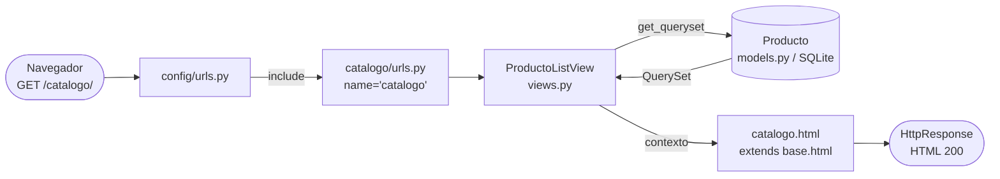

# Catálogo de Productos Tecnológicos (Django)

Aplicación web desarrollada con **Django 6.1** bajo el patrón **MTV (Model – Template – View)**. Muestra un catálogo de productos tecnológicos con una página de bienvenida, un listado filtrable por categoría y disponibilidad, y administración de productos desde el panel de Django.

---

## Contenido

1. [Tecnologías](#tecnologías)
2. [Instalación y ejecución](#instalación-y-ejecución)
3. [Estructura de carpetas](#estructura-de-carpetas)
4. [Arquitectura MTV](#arquitectura-mtv)
5. [Rutas y vistas](#rutas-y-vistas)
6. [Modelo de datos](#modelo-de-datos)
7. [QuerySets y lazy evaluation](#querysets-y-lazy-evaluation)
8. [Plantillas](#plantillas)
9. [Validación técnica](#validación-técnica)
10. [Capturas](#capturas)

---

## Tecnologías

| Componente | Versión |
|---|---|
| Python | 3.14 |
| Django | 6.1.3 |
| Base de datos | SQLite 3 |

## Instalación y ejecución

```bash
# 1. Crear y activar el entorno virtual
python -m venv venv
venv\Scripts\activate          # Windows
# source venv/bin/activate     # Linux / macOS

# 2. Instalar dependencias
pip install -r requirements.txt

# 3. Crear las tablas y cargar los datos de ejemplo
python manage.py makemigrations
python manage.py migrate
python manage.py loaddata productos

# 4. (Opcional) Crear un usuario para el panel de administración
python manage.py createsuperuser

# 5. Iniciar el servidor
python manage.py runserver
```

| URL | Descripción |
|---|---|
| http://127.0.0.1:8000/ | Página de bienvenida (FBV) |
| http://127.0.0.1:8000/catalogo/ | Catálogo de productos (CBV `ListView`) |
| http://127.0.0.1:8000/admin/ | Panel de administración |

> **Variables de entorno (producción):** `DJANGO_SECRET_KEY` define la clave secreta y `DJANGO_DEBUG=False` desactiva el modo de depuración. Sin ellas se usan valores de desarrollo.

## Estructura de carpetas

```text
.
├── config/                    # Proyecto Django (configuración global)
│   ├── __init__.py
│   ├── asgi.py
│   ├── settings.py            # Apps instaladas, templates, BD, idioma
│   ├── urls.py                # URLs raíz: admin/ + include('catalogo.urls')
│   └── wsgi.py
├── catalogo/                  # App del catálogo
│   ├── fixtures/
│   │   └── productos.json     # 12 productos de ejemplo
│   ├── migrations/
│   │   └── 0001_initial.py
│   ├── templatetags/
│   │   └── catalogo_extras.py # Filtro personalizado |moneda
│   ├── admin.py               # Registro de Producto en el admin
│   ├── apps.py
│   ├── models.py              # Modelo Producto
│   ├── tests.py               # Pruebas automáticas
│   ├── urls.py                # Rutas '' y 'catalogo/'
│   └── views.py               # home (FBV) y ProductoListView (CBV)
├── templates/
│   ├── base.html              # Plantilla base: header, nav, content, footer
│   ├── home.html              # Bienvenida
│   ├── catalogo.html          # Listado de productos
│   └── 404.html               # Página de error personalizada
├── .gitignore
├── manage.py
├── README.md
└── requirements.txt
```

## Arquitectura MTV

Django separa la aplicación en tres capas:

| Capa | Responsabilidad | Archivo |
|---|---|---|
| **Model** | Define los datos y accede a la BD mediante el ORM | `catalogo/models.py` |
| **View** | Recibe la petición, aplica la lógica y arma el contexto | `catalogo/views.py` |
| **Template** | Presenta los datos en HTML | `templates/*.html` |

Equivale al patrón MVC: el *Controller* de MVC es la **View** de Django y la *View* de MVC es el **Template**.

### Flujo de una petición



Versión en texto:

```text
Request ─► config/urls.py ─► catalogo/urls.py ─► View ─► Model (ORM ↔ SQLite)
                                                   │
                                                   ▼
Response ◄──────────── HTML renderizado ◄──── Template (catalogo.html + base.html)
```

## Rutas y vistas

```python
# config/urls.py
urlpatterns = [
    path("admin/", admin.site.urls),
    path("", include("catalogo.urls")),
]

# catalogo/urls.py
urlpatterns = [
    path("", views.home, name="home"),
    path("catalogo/", views.ProductoListView.as_view(), name="catalogo"),
]
```

- **`home` (FBV):** consulta totales, categorías y los 3 productos destacados, y los envía a `home.html` con `render()`. Si la BD no está disponible captura `DatabaseError` y muestra un aviso en lugar de un error 500.
- **`ProductoListView` (CBV):** define `template_name = "catalogo.html"`, `context_object_name = "productos"` y sobrescribe `get_queryset()` para ordenar por precio y aplicar filtros por GET (`?categoria=Audio`, `?disponibles=1`). `get_context_data()` agrega las categorías y los contadores de disponibles y agotados.
- Los enlaces de las plantillas usan los nombres de ruta: `` y ``.

## Modelo de datos

```python
class Producto(models.Model):
    nombre      = models.CharField(max_length=100)
    descripcion = models.TextField(blank=True)
    precio      = models.DecimalField(max_digits=8, decimal_places=2)
    categoria   = models.CharField(max_length=50, choices=Categoria.choices)
    stock       = models.PositiveIntegerField(default=0)
    creado_en   = models.DateTimeField(auto_now_add=True)
```

| Campo | Tipo | Descripción |
|---|---|---|
| `nombre` | CharField(100) | Nombre comercial |
| `descripcion` | TextField | Detalle opcional |
| `precio` | DecimalField(8,2) | Precio en soles, no negativo |
| `categoria` | CharField + choices | Laptops, Smartphones, Audio, Monitores, Accesorios |
| `stock` | PositiveIntegerField | Unidades disponibles |
| `creado_en` | DateTimeField | Fecha de registro automática |

Migraciones: `makemigrations` generó `catalogo/migrations/0001_initial.py` y `migrate` creó la tabla `catalogo_producto` en SQLite.

## QuerySets y lazy evaluation

### QuerySet 1: listado ordenado y filtrado (`ProductoListView.get_queryset`)

```python
queryset = Producto.objects.order_by("precio")
if categoria in Producto.Categoria.values:
    queryset = queryset.filter(categoria=categoria)
if self.request.GET.get("disponibles") == "1":
    queryset = queryset.filter(stock__gt=0)
```

SQL generado para `/catalogo/?categoria=Audio&disponibles=1`:

```sql
SELECT ... FROM catalogo_producto
WHERE categoria = 'Audio' AND stock > 0
ORDER BY precio ASC;
```

### QuerySet 2: productos destacados (`home`)

```python
Producto.objects.filter(stock__gt=0).order_by("-precio")[:3]
```

Devuelve los 3 productos con stock más caros. El corte `[:3]` se traduce en `LIMIT 3` dentro del SQL, así que no se traen todos los registros a memoria.

### ¿Qué es la lazy evaluation?

Un QuerySet es **perezoso (lazy)**: crearlo, filtrarlo u ordenarlo **no ejecuta ninguna consulta**. Django solo va construyendo la sentencia SQL. La consulta llega a la base de datos cuando el QuerySet se **evalúa**, por ejemplo:

- al recorrerlo con `for` (como hace `` en la plantilla),
- con `list()`, `len()` o `bool()`,
- al acceder por índice o hacer *slicing* con paso,
- al llamar a `.count()`, `.exists()` o `.aggregate()`, que ejecutan su propia consulta.

En `get_queryset()` se encadenan hasta tres operaciones (`order_by`, `filter`, `filter`) y **se ejecuta una sola consulta SQL**, recién cuando la plantilla recorre los productos. Esto evita consultas innecesarias y permite armar filtros de forma dinámica. Además, una vez evaluado, el QuerySet guarda los resultados en caché y los reutiliza si se vuelve a recorrer.

Se puede comprobar en la consola:

```python
>>> from catalogo.models import Producto
>>> qs = Producto.objects.filter(stock__gt=0).order_by("precio")  # sin consulta
>>> print(qs.query)   # muestra el SQL que se ejecutará
>>> len(qs)           # aquí recién se consulta la BD
```

## Plantillas

| Recurso | Uso |
|---|---|
| Herencia | `home.html`, `catalogo.html` y `404.html` usan `` |
| Bloques | `` y `` |
| Tags | `…`, `//`, ``, ``, `` |
| Filtros nativos | `title`, `upper`, `truncatechars`, `truncatewords`, `default`, `date`, `pluralize`, `length`, `urlencode` |
| Filtro propio | `moneda`: `{{ producto.precio\|moneda }}` → `S/ 1,299.00` |
| Condicional de stock | `stock == 0` → **Agotado**; `stock <= 5` → **¡Últimas unidades!**; si no → stock normal |
| Responsive | CSS Grid con `auto-fill/minmax` y `@media (max-width: 600px)` |

## Validación técnica

```bash
python manage.py check        # System check identified no issues (0 silenced).
python manage.py test catalogo # Ran 6 tests ... OK
```

| Ruta | Código HTTP |
|---|---|
| `/` | 200 |
| `/catalogo/` | 200 |
| `/catalogo/?categoria=Audio` | 200 |
| `/catalogo/?disponibles=1` | 200 |
| `/admin/login/` | 200 |
| `/ruta-inexistente/` | 404 (respuesta esperada) |

## Capturas

> Las imágenes se encuentran en la carpeta `capturas/` de la raíz del proyecto.

### Catálogo renderizado (`/catalogo/`)


### Catálogo filtrado (`/catalogo/?categoria=Laptops`)


### Estructura de carpetas


### Página de inicio (`/`)


### Vista en dispositivo móvil


### Migraciones y carga de datos


### `check` y pruebas automatizadas


### Servidor en ejecución


# SEMANA-11---PRACTICA--DAW---02

