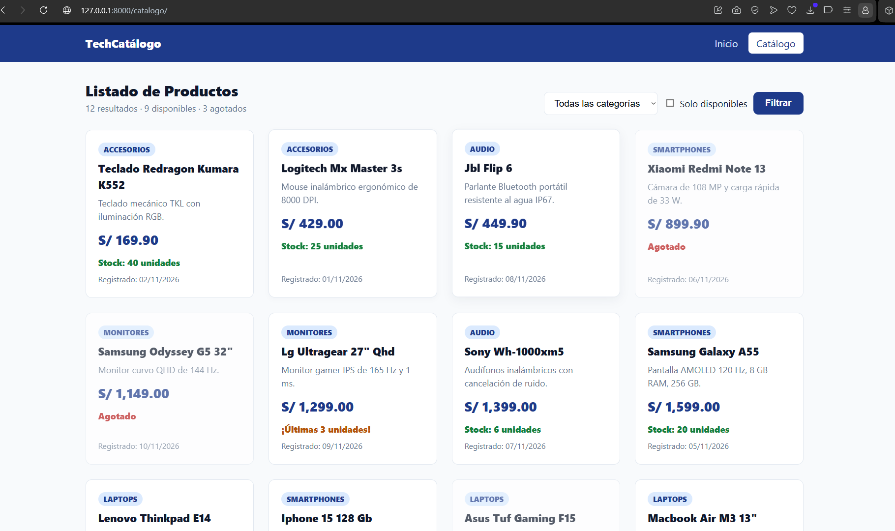
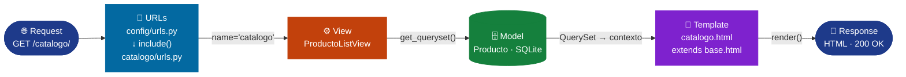
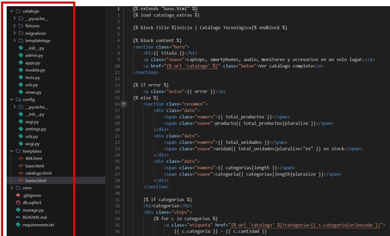
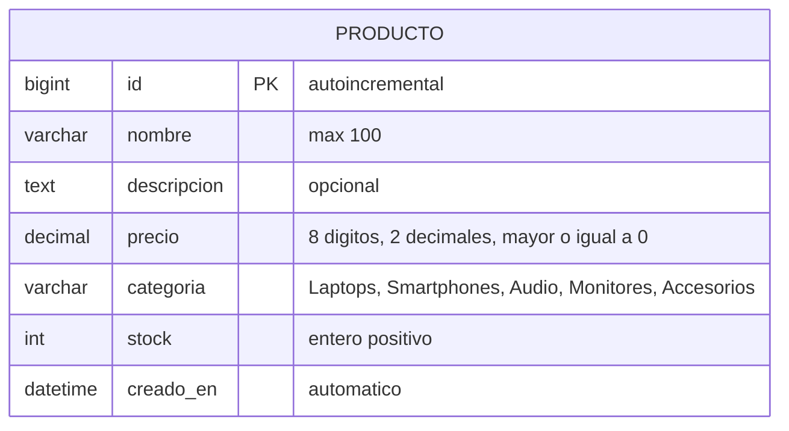
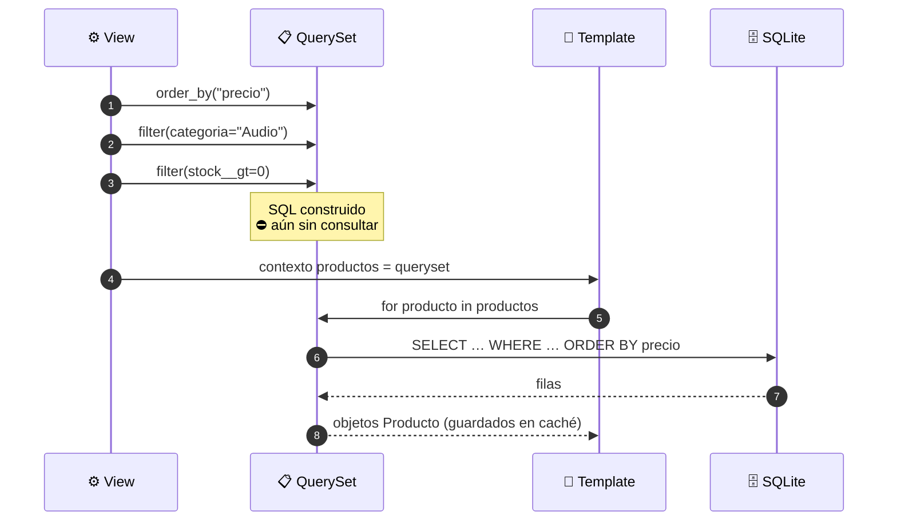
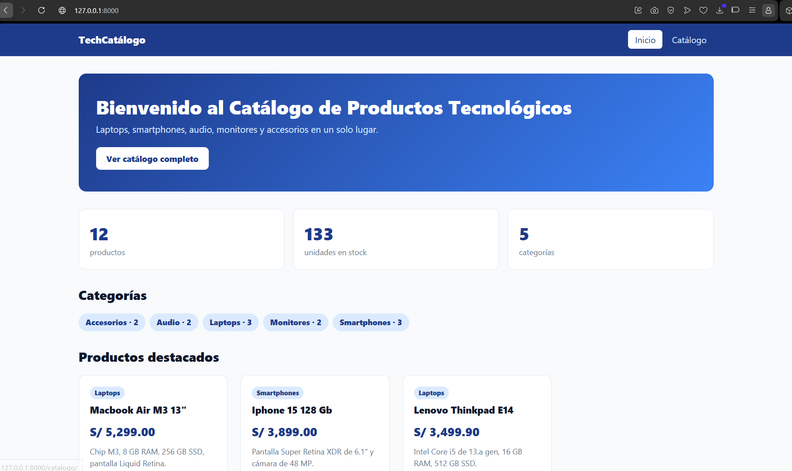
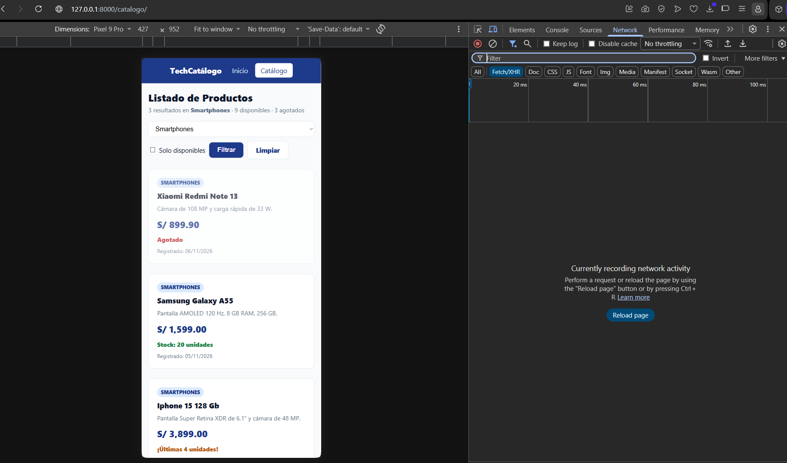
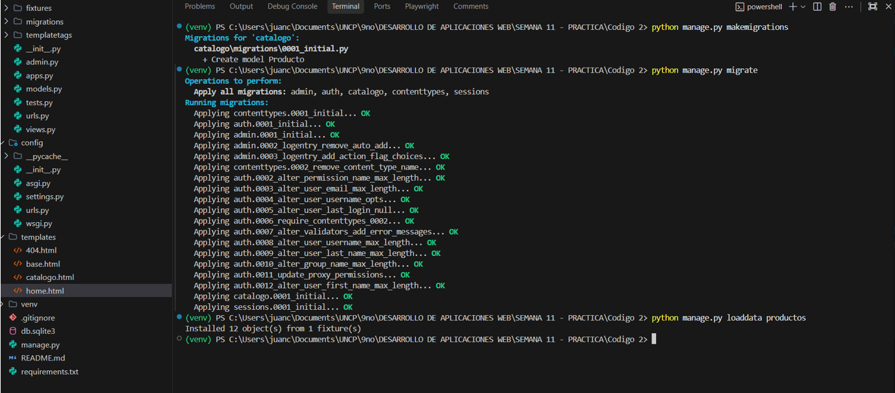
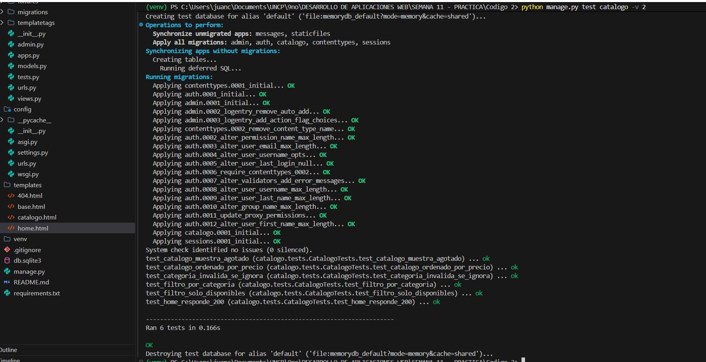
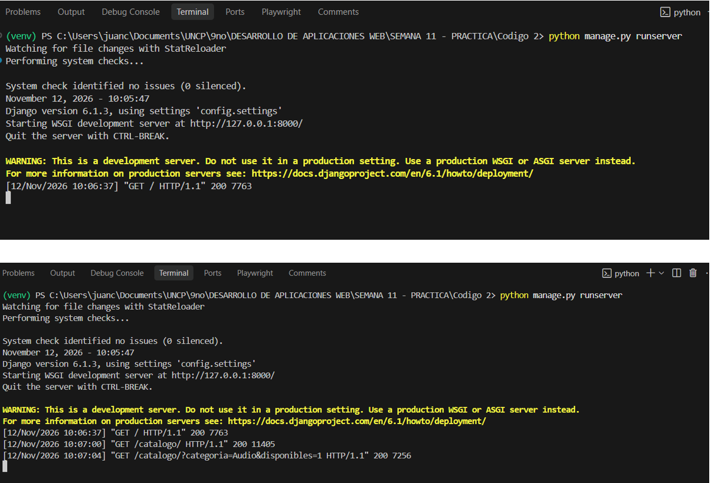

<div align="center">

# 🛒 TechCatálogo

### Catálogo de Productos Tecnológicos con Django

Aplicación web construida con **Django** bajo el patrón **MTV (Model – Template – View)**,<br>
con listado filtrable, ORM, migraciones y plantillas reutilizables.

<br>


<br>

[Características](#-características) •
[Instalación](#-instalación) •
[Arquitectura](#️-arquitectura-mtv) •
[Modelo](#️-modelo-de-datos) •
[QuerySets](#-querysets-y-lazy-evaluation) •
[Capturas](#-capturas) •
[Validación](#-validación-técnica)

<br>



</div>

---

## ✨ Características

- 🏠 **Página de bienvenida** con indicadores en tiempo real: total de productos, unidades en stock, categorías y productos destacados.
- 📦 **Catálogo de productos** ordenado por precio, con tarjetas que muestran la categoría, la descripción, el precio y el estado del stock.
- 🔎 **Filtros** por categoría y por disponibilidad (`?categoria=Laptops&disponibles=1`).
- 🚦 **Estado del stock con colores**: <kbd>Stock: N unidades</kbd> · <kbd>¡Últimas N unidades!</kbd> (≤ 5) · <kbd>Agotado</kbd> (0).
- 💰 **Filtro de plantilla propio** `|moneda` que muestra los precios como `S/ 1,299.00`.
- 📱 **Diseño responsive** con CSS Grid y media queries.
- 🛠️ **Panel de administración** con búsqueda, filtros y edición rápida de precio y stock.
- 🧯 **Manejo de errores**: página 404 personalizada y captura de `DatabaseError` en la vista.
- ✅ **6 pruebas automatizadas** sobre vistas, filtros y plantillas.

---

## 🧰 Tecnologías

| Tecnología | Versión | Uso |
|:--|:--:|:--|
| **Python** | 3.14 | Lenguaje de programación |
| **Django** | 6.1.3 | Framework web (MTV, ORM, plantillas, admin) |
| **SQLite** | 3 | Base de datos relacional embebida |
| **HTML5 + CSS3** | — | Plantillas y estilos (Grid, Flexbox, media queries) |

---

## 🚀 Instalación

> [!NOTE]
> Requisitos: **Python 3.12 o superior** y **Git**.

**1. Clonar el repositorio**

```bash
git clone https://github.com/devjuancarlos10/SEMANA-11---PRACTICA--DAW---02.git
cd SEMANA-11---PRACTICA--DAW---02
```

**2. Crear y activar el entorno virtual**

```bash
python -m venv venv

# Windows
venv\Scripts\activate

# Linux / macOS
source venv/bin/activate
```

**3. Instalar las dependencias**

```bash
pip install -r requirements.txt
```

**4. Crear la base de datos y cargar los productos de ejemplo**

```bash
python manage.py migrate
python manage.py loaddata productos
```

**5. (Opcional) Crear un usuario administrador**

```bash
python manage.py createsuperuser
```

**6. Iniciar el servidor**

```bash
python manage.py runserver
```

### 🌐 Rutas disponibles

| URL | Nombre | Vista | Descripción |
|:--|:--:|:--|:--|
| [`/`](http://127.0.0.1:8000/) | `home` | `home` · **FBV** | Página de bienvenida |
| [`/catalogo/`](http://127.0.0.1:8000/catalogo/) | `catalogo` | `ProductoListView` · **CBV** | Listado de productos |
| [`/catalogo/?categoria=Audio`](http://127.0.0.1:8000/catalogo/?categoria=Audio) | `catalogo` | `ProductoListView` · **CBV** | Filtro por categoría |
| [`/catalogo/?disponibles=1`](http://127.0.0.1:8000/catalogo/?disponibles=1) | `catalogo` | `ProductoListView` · **CBV** | Solo productos con stock |
| [`/admin/`](http://127.0.0.1:8000/admin/) | — | Django Admin | Panel de administración |

> [!TIP]
> En producción define las variables de entorno `DJANGO_SECRET_KEY` (clave secreta) y `DJANGO_DEBUG=False`. Sin ellas se usan valores pensados solo para desarrollo.

---

## 🏛️ Arquitectura MTV

Django organiza la aplicación en tres capas. Es el mismo patrón **MVC** con otros nombres: el *Controller* de MVC es la **View** de Django y la *View* de MVC es el **Template**.

| Capa | Responsabilidad | Archivo |
|:--|:--|:--|
| 🟢 **Model** | Define los datos y accede a la base de datos mediante el ORM | `catalogo/models.py` |
| 🟠 **View** | Recibe la petición, aplica la lógica y arma el contexto | `catalogo/views.py` |
| 🟣 **Template** | Presenta los datos en HTML | `templates/*.html` |

### Flujo de una petición



1. El **navegador** envía la petición `GET /catalogo/`.
2. `config/urls.py` la delega con `include()` a `catalogo/urls.py`, que encuentra la ruta llamada `catalogo`.
3. Se ejecuta **`ProductoListView`**, que arma el QuerySet en `get_queryset()`.
4. El **modelo `Producto`** obtiene los registros de SQLite mediante el ORM.
5. La **plantilla** `catalogo.html` (que hereda de `base.html`) recibe el contexto y genera el HTML.
6. Django devuelve la **respuesta** HTTP 200 al navegador.

---

## 📁 Estructura del proyecto

```text
📦 TechCatálogo
 ┣ 📂 config/                     → Proyecto Django (configuración global)
 ┃ ┣ 📜 settings.py               → Apps, plantillas, BD, idioma y zona horaria
 ┃ ┣ 📜 urls.py                   → admin/ + include("catalogo.urls")
 ┃ ┣ 📜 asgi.py
 ┃ ┗ 📜 wsgi.py
 ┣ 📂 catalogo/                   → Aplicación del catálogo
 ┃ ┣ 📂 fixtures/
 ┃ ┃ ┗ 📜 productos.json          → 12 productos de ejemplo
 ┃ ┣ 📂 migrations/
 ┃ ┃ ┗ 📜 0001_initial.py         → Crea la tabla catalogo_producto
 ┃ ┣ 📂 templatetags/
 ┃ ┃ ┗ 📜 catalogo_extras.py      → Filtro personalizado |moneda
 ┃ ┣ 📜 admin.py                  → Registro de Producto en el admin
 ┃ ┣ 📜 models.py                 → Modelo Producto
 ┃ ┣ 📜 tests.py                  → Pruebas automatizadas
 ┃ ┣ 📜 urls.py                   → Rutas "" y "catalogo/"
 ┃ ┗ 📜 views.py                  → home (FBV) y ProductoListView (CBV)
 ┣ 📂 templates/
 ┃ ┣ 📜 base.html                 → Header, nav, bloque content y footer
 ┃ ┣ 📜 home.html                 → Página de bienvenida
 ┃ ┣ 📜 catalogo.html             → Listado de productos
 ┃ ┗ 📜 404.html                  → Página de error personalizada
 ┣ 📂 capturas/                   → Imágenes de este README
 ┣ 📜 .gitignore
 ┣ 📜 manage.py
 ┣ 📜 README.md
 ┗ 📜 requirements.txt
```

<details>
<summary><b>📸 Ver captura de la estructura en el editor</b></summary>
<br>
<p align="center"></p>
</details>

---

## 🗄️ Modelo de datos



```python
class Producto(models.Model):
    class Categoria(models.TextChoices):
        LAPTOPS = "Laptops", "Laptops"
        SMARTPHONES = "Smartphones", "Smartphones"
        AUDIO = "Audio", "Audio"
        MONITORES = "Monitores", "Monitores"
        ACCESORIOS = "Accesorios", "Accesorios"

    nombre = models.CharField(max_length=100)
    descripcion = models.TextField(blank=True)
    precio = models.DecimalField(max_digits=8, decimal_places=2,
                                 validators=[MinValueValidator(0)])
    categoria = models.CharField(max_length=50, choices=Categoria.choices)
    stock = models.PositiveIntegerField(default=0)
    creado_en = models.DateTimeField(auto_now_add=True)

    class Meta:
        verbose_name_plural = "Productos"
        ordering = ["-creado_en"]

    def __str__(self):
        return f"{self.nombre} ({self.categoria})"
```

**Migraciones:** `makemigrations` generó `catalogo/migrations/0001_initial.py` y `migrate` creó la tabla `catalogo_producto` en SQLite.

---

## ⚙️ Vistas

<table>
<tr>
<th width="50%">🔹 FBV · <code>home</code></th>
<th width="50%">🔸 CBV · <code>ProductoListView</code></th>
</tr>
<tr>
<td valign="top">

```python
def home(request):
    contexto = {...}
    try:
        contexto["total_productos"] = (
            Producto.objects.count())
        contexto["destacados"] = (
            Producto.objects
            .filter(stock__gt=0)
            .order_by("-precio")[:3])
    except DatabaseError:
        contexto["error"] = "..."
    return render(request,
                  "home.html", contexto)
```

</td>
<td valign="top">

```python
class ProductoListView(ListView):
    model = Producto
    template_name = "catalogo.html"
    context_object_name = "productos"

    def get_queryset(self):
        qs = Producto.objects.order_by("precio")
        cat = self.request.GET.get("categoria")
        if cat in Producto.Categoria.values:
            qs = qs.filter(categoria=cat)
        if self.request.GET.get("disponibles") == "1":
            qs = qs.filter(stock__gt=0)
        return qs
```

</td>
</tr>
<tr>
<td>Lógica explícita y lineal. Arma un resumen del catálogo y, si la base de datos no responde, muestra un aviso en lugar de un error 500.</td>
<td>Vista genérica reutilizable. Sobrescribe <code>get_queryset()</code> para ordenar y filtrar, y <code>get_context_data()</code> para agregar los contadores.</td>
</tr>
</table>

---

## 🔍 QuerySets y lazy evaluation

### QuerySet 1 · Listado ordenado y filtrado

Se construye en `ProductoListView.get_queryset()`:

```python
queryset = Producto.objects.order_by("precio")
queryset = queryset.filter(categoria="Audio")   # si llega ?categoria=Audio
queryset = queryset.filter(stock__gt=0)         # si llega ?disponibles=1
```

Las tres operaciones se combinan en **una sola** consulta SQL:

```sql
SELECT * FROM catalogo_producto
WHERE categoria = 'Audio' AND stock > 0
ORDER BY precio ASC;
```

### QuerySet 2 · Productos destacados

Se usa en la vista `home`:

```python
Producto.objects.filter(stock__gt=0).order_by("-precio")[:3]
```

```sql
SELECT * FROM catalogo_producto
WHERE stock > 0
ORDER BY precio DESC
LIMIT 3;
```

El corte `[:3]` no recorta una lista en memoria: se traduce en `LIMIT 3` dentro de la consulta.

### 💤 ¿Qué es la lazy evaluation?

Un QuerySet es **perezoso**: crearlo, filtrarlo u ordenarlo **no consulta la base de datos**. Django solo va construyendo la sentencia SQL, y la ejecuta cuando el QuerySet **se evalúa**.



| ✅ Evalúan el QuerySet (consultan la BD) | ❌ No lo evalúan |
|:--|:--|
| Recorrerlo con `for` (en Python o en la plantilla) | `filter()`, `exclude()` |
| `list()`, `len()`, `bool()` | `order_by()`, `values()` |
| Slicing con paso (`qs[::2]`) | Slicing simple (`qs[:3]` → `LIMIT`) |
| `count()`, `exists()`, `aggregate()` (ejecutan su propia consulta) | Encadenar QuerySets |

**Ventajas:** se pueden armar filtros de forma dinámica sin lanzar consultas intermedias, y una vez evaluado, el QuerySet guarda los resultados en caché para reutilizarlos.

Puedes comprobarlo en la consola con `python manage.py shell`:

```python
>>> from catalogo.models import Producto
>>> qs = Producto.objects.filter(stock__gt=0).order_by("precio")  # sin consulta
>>> print(qs.query)    # muestra el SQL, todavía sin ejecutarlo
>>> len(qs)            # aquí recién se consulta la BD
9
```

---

## 🎨 Plantillas

| Recurso | Uso en el proyecto |
|:--|:--|
| **Herencia** | `home.html`, `catalogo.html` y `404.html` usan `` |
| **Bloques** | `` y `` |
| **Etiquetas** | `…`, `//`, ``, ``, `` |
| **Filtros nativos** | `title`, `upper`, `truncatechars`, `truncatewords`, `default`, `date`, `pluralize`, `length`, `urlencode` |
| **Filtro propio** | `moneda` → `{{ producto.precio\|moneda }}` → `S/ 1,299.00` |
| **Enlaces con nombre** | `` y `` (sin URLs escritas a mano) |
| **Responsive** | `grid-template-columns: repeat(auto-fill, minmax(250px, 1fr))` + `@media (max-width: 600px)` |

Este es el condicional del stock en `catalogo.html`:

```django

    <p class="stock agotado">Agotado</p>

    <p class="stock bajo">¡Últimas {{ producto.stock }} unidades!</p>

    <p class="stock ok">Stock: {{ producto.stock }} unidades</p>

```

---

## 📸 Capturas

### Catálogo · `/catalogo/`
<p align="center"></p>

<table>
<tr>
<td width="50%" align="center"><b>🏠 Inicio · <code>/</code></b></td>
<td width="50%" align="center"><b>🔎 Catálogo filtrado · <code>?categoria=Smartphones</code></b></td>
</tr>
<tr>
<td></td>
<td></td>
</tr>
<tr>
<td width="50%" align="center"><b>📱 Vista móvil</b></td>
<td width="50%" align="center"><b>📁 Estructura de carpetas</b></td>
</tr>
<tr>
<td align="center"></td>
<td align="center"></td>
</tr>
</table>

---

## ✅ Validación técnica

```bash
python manage.py check           # System check identified no issues (0 silenced).
python manage.py test catalogo   # Ran 6 tests ... OK
```

| Ruta | Código | Resultado |
|:--|:--:|:--|
| `/` |  | Página de bienvenida |
| `/catalogo/` |  | 12 productos listados |
| `/catalogo/?categoria=Audio` |  | Filtro por categoría |
| `/catalogo/?disponibles=1` |  | Solo productos con stock |
| `/admin/login/` |  | Panel de administración |
| `/ruta-inexistente/` |  | Página 404 personalizada |

<details>
<summary><b>🧪 Pruebas automatizadas (6)</b></summary>
<br>

| Prueba | Qué verifica |
|:--|:--|
| `test_home_responde_200` | La página de inicio responde y usa `home.html` |
| `test_catalogo_ordenado_por_precio` | Los productos llegan ordenados por precio |
| `test_catalogo_muestra_agotado` | Se muestran «Agotado», el filtro `title` y el filtro `moneda` |
| `test_filtro_por_categoria` | `?categoria=` devuelve solo esa categoría |
| `test_filtro_solo_disponibles` | `?disponibles=1` excluye los productos sin stock |
| `test_categoria_invalida_se_ignora` | Una categoría inexistente no rompe la vista |

</details>

<details>
<summary><b>🖥️ Capturas de la terminal</b></summary>
<br>

**Migraciones y carga de datos**
<p align="center"></p>

**`check` y pruebas automatizadas**
<p align="center"></p>

**Servidor en ejecución**
<p align="center"></p>

</details>

---

## 🔒 Buenas prácticas aplicadas

- 🔑 `SECRET_KEY` y `DEBUG` se leen de variables de entorno.
- 🚫 `.gitignore` excluye `venv/`, `db.sqlite3`, `__pycache__/` y `.env`.
- 🧭 Rutas con `name=` y ``, sin URLs escritas a mano en las plantillas.
- 🛡️ Los filtros de la URL se validan contra las categorías permitidas antes de consultar.
- 🧯 La vista `home` captura `DatabaseError` y muestra un aviso en lugar de un error 500.

<div align="center">

---

Hecho con 🐍 **Python** y 💚 **Django**

</div>
